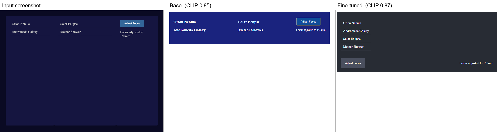

# Screenshot to React

Fine-tuning **Qwen2.5-VL-3B-Instruct** with **LoRA** to turn a UI screenshot into a React component plus its CSS.

The training loop is written by hand in plain PyTorch, with no `Trainer` or TRL, to show every step of fine-tuning a vision-language model. The evaluation renders the generated pages in a headless browser and compares them with the input screenshots.

**Model:** [Huggyb/screenshot2react-qwen2.5vl-3b-lora](https://huggingface.co/Huggyb/screenshot2react-qwen2.5vl-3b-lora) (LoRA adapter, 30 MB)

```
screenshot.png  ──►  Qwen2.5-VL-3B + LoRA  ──►  ```jsx ... ```  +  ```css ... ```
```

## Results

All 80 screenshots of [Flame-Eval-React](https://huggingface.co/datasets/Flame-Code-VLM/Flame-Eval-React), greedy decoding. A page that doesn't render scores 0. Columns marked `*` count only pages that rendered.

| | Format | JSX parses | Renders | CLIP | SSIM | CLIP\* | SSIM\* |
|---|---|---|---|---|---|---|---|
| Base Qwen2.5-VL-3B | 100% | 100% | 74/80 | 0.769 | 0.773 | 0.832 | **0.836** |
| **Fine-tuned (this repo)** | 100% | 99% | **78/80** | **0.838** | **0.796** | **0.860** | 0.817 |
| Reference answers | 100% | 99% | 79/80 | 0.957 | 0.938 | 0.969 | 0.950 |

For scale: two *different* pages score about **CLIP 0.70 / SSIM 0.78**, and the reference answers mark the top end.

**What fine-tuning changed:**
- **More pages render** (74 → 78). On the hardest level, base fails 4 of 22 pages and the fine-tuned model renders all 22.
- **Pages look more like the screenshot.** CLIP rises from 0.769 to 0.838. The fine-tuned model wins on 50 of the 73 pages both models rendered. On rendered pages it covers 59% of the distance from "unrelated page" to "reference answer"; base covers 49%.
- **Answers are fuller.** They average 682 tokens instead of 367: more of the page's content, its colours, cards and shadows.
- **Layout did not improve.** On pages both rendered, SSIM is about a coin flip (fine-tuned wins 36 of 73). The model often stacks sections that should sit side by side. Base partly scores well on SSIM because its pages are short and mostly empty, and empty space resembles a light background.
- **It writes code in the style of its training data.** It uses `formik`/`yup`, `@material-ui/core` (MUI v4) and `react-router` v5, from GitHub repos of roughly 2019–2022.

**Typical example** (the median CLIP gain):



**Biggest gain:**


### Training curve

Validation loss on 500 held-out rows, every 500 steps:

| Step | 500 | 1000 | 2000 | 3000 | 4000 | 5000 | 6000 | 7000 | 8000 | 9000 | final (9695) |
|---|---|---|---|---|---|---|---|---|---|---|---|
| Val loss | 0.193 | 0.175 | 0.162 | 0.155 | 0.150 | 0.146 | 0.144 | 0.142 | 0.141 | 0.140 | **0.140** |

The loss improved at every check, with no sign of overfitting, and it was flat for the last ~1,500 steps. Training loss went from 0.28 at the start to 0.13. There were 0 skipped (non-finite) batches.

## Data

| | Dataset | Rows | Use |
|---|---|---|---|
| Training | [Flame-Code-VLM/Flame-Waterfall-React](https://huggingface.co/datasets/Flame-Code-VLM/Flame-Waterfall-React), single-image file | 166,000 | 95% train, 5% validation |
| Test | [Flame-Code-VLM/Flame-Eval-React](https://huggingface.co/datasets/Flame-Code-VLM/Flame-Eval-React) | 80 | never trained on |

Each training example is a chat: a system prompt, the screenshot with a short instruction, and the answer as two code blocks (`jsx`, then `css`). Examples longer than 4,096 tokens are dropped rather than cut off. That removes about 1.8% of the data and leaves **155,125 training examples**.

## Training setup

| Setting | Value |
|---|---|
| Base model | `Qwen/Qwen2.5-VL-3B-Instruct`, bf16, SDPA attention |
| Image size | at most 1280 × 28 × 28 pixels (≤ 1,280 image tokens) |
| LoRA | r = 16, alpha = 32, dropout 0.05, on `q_proj`, `k_proj`, `v_proj`, `o_proj` (7.4 M trainable parameters, 0.2%) |
| Loss | only on the answer tokens; the prompt, image and padding are masked with -100 |
| Batch | 1 × 16 gradient accumulation = 16 examples per update, 9,695 updates (1 epoch) |
| Optimizer | AdamW, lr 1e-4, weight decay 0.01, gradient clipping 1.0 |
| Schedule | 5% linear warmup, then cosine decay |
| Memory | gradient checkpointing, bf16 autocast |
| Hardware | 1× H100 SXM 80 GB, about 34 hours |

### Lessons from the training run

- **`nan` gradients with batch size 2.** The loss was always finite, but about 13% of updates had `nan` gradients. With batch size 1 there is no padding inside a batch, and the problem disappeared completely. The loop also has a guard that undoes a single bad batch, so one `nan` can never poison the weights.
- **The GPU was waiting for data.** With `num_workers=0`, the GPU was busy only 44% of the time, because one CPU core prepared every batch. 8 DataLoader workers fixed it.
- **Validation cost.** Validating all 8,300 held-out rows every 100 steps would have cost more than training. 500 rows every 500 steps took 79 seconds per check and still ranked the checkpoints clearly.

## Evaluation

Three phases, each with its own script:

1. **Generate** (`evaluate.py`, GPU). Greedy decoding on all 80 test screenshots. It checks whether the answer has exactly the `jsx` and `css` blocks.
2. **Syntax** (`syntax_check.mjs`). Does the JSX parse (`@babel/parser`)? Does it `export default` a component? Does the CSS parse (`postcss`)? Which packages does it import?
3. **Visual** (`render.mjs` and `visual_score.py`):
   - Each answer is bundled with esbuild and opened in headless Chromium at the screenshot's size, then screenshotted.
   - The screenshot is compared with the input image using **CLIP** image similarity (does it look like the same page?) and **SSIM** (is the layout the same?).

**Rendering environment:** React 18.3.1, react-router-dom v5, MUI v9 and MUI v4 (`@material-ui/core`), plus the packages the models import (see `package.json`). Network requests are blocked, so remote images and web fonts don't load. This affects every run equally.

React 18 was chosen because the model writes code from the React 16–18 era. Under React 19, which removed `findDOMNode`, and react-router v7, which removed `Switch`, the fine-tuned model renders 72/80 instead of 78/80. Base and the reference answers are unchanged.

## Project layout

| File | What it does |
|---|---|
| `prepare.py` | Downloads Flame-Waterfall-React, splits it and builds the chat-format dataset (`data/flame_clean`) |
| `train.py` | Length filter (`data/filtered_flame`), collator, LoRA, training and validation loop, saving checkpoints |
| `evaluate.py` | Phase 1: generates answers for Flame-Eval-React and writes `outputs/eval/<name>.jsonl` |
| `syntax_check.mjs` | Phase 2: syntax checks |
| `prepare_refs.py` | Saves the test screenshots and the reference answers (`gold.jsonl`) |
| `render.mjs` | Phase 3: builds and screenshots every answer |
| `visual_score.py` | Phase 3: CLIP and SSIM scores, plus side-by-side images |

## How to run

**Training and generation (GPU)**
```bash
pip install -r requirements.txt          # plus a CUDA build of torch and torchvision
python -u train.py 2>&1 | tee train.log  # first run also builds the datasets (prepare.py)
python evaluate.py --name base
python evaluate.py --name finetuned --adapter Huggyb/screenshot2react-qwen2.5vl-3b-lora
```

**Syntax and visual checks (CPU, Node.js 18+)**
```bash
npm install --legacy-peer-deps
npx playwright install chromium
python prepare_refs.py
node syntax_check.mjs outputs/eval/finetuned.jsonl
node render.mjs outputs/eval/gold.jsonl
node render.mjs outputs/eval/base.jsonl
node render.mjs outputs/eval/finetuned.jsonl
python visual_score.py gold base finetuned
```

## Limitations

- **The layout is the weak spot.** Multi-column arrangements are often stacked vertically.
- **The code is dated.** It uses libraries and APIs from older React projects, which may need older package versions to run.
- **Small test set.** 80 test pages is small, so differences of 1–2 pages are within noise.
- **Row-level split.** The train/validation split is by row, so pages from the same source repository can appear in both. Validation loss was only used to monitor training. The test set is fully separate.
- **One broken reference answer.** One of the 80 reference answers has a syntax error in the dataset itself (`000000007`), so no comparison against a working reference is possible on that row.
